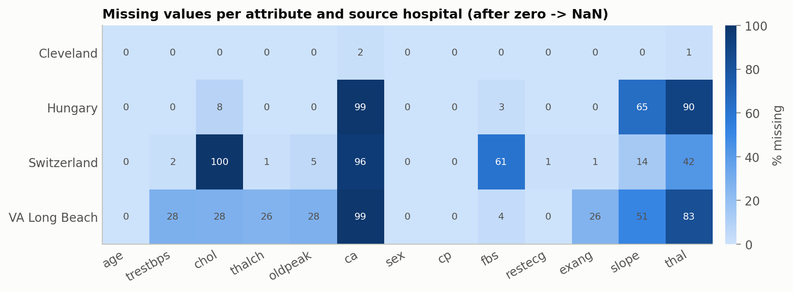
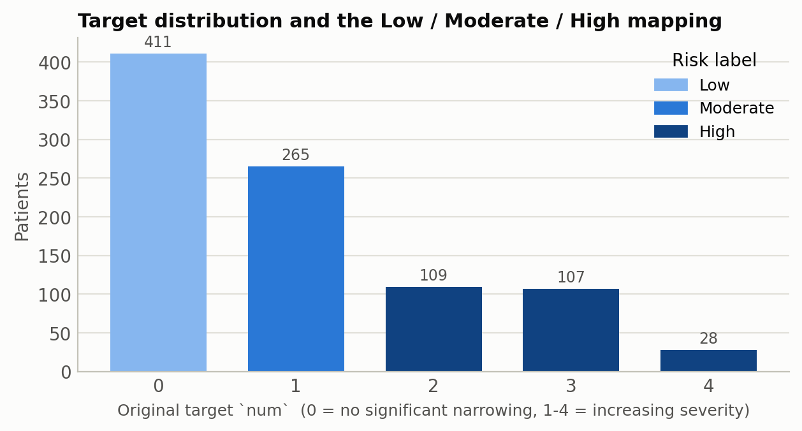
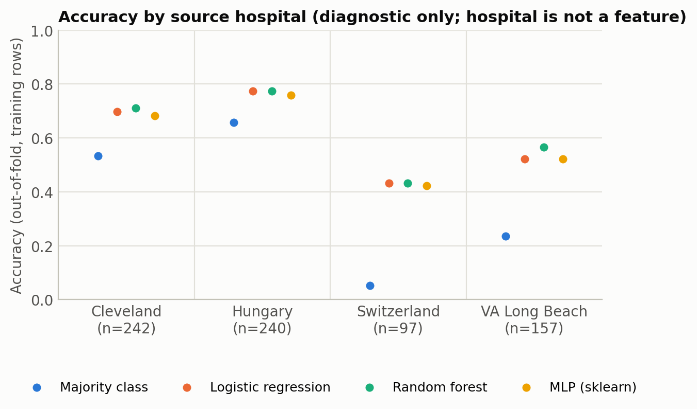
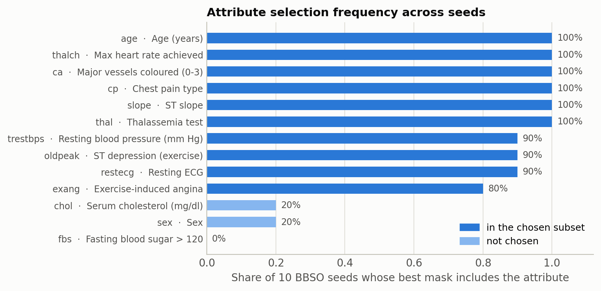
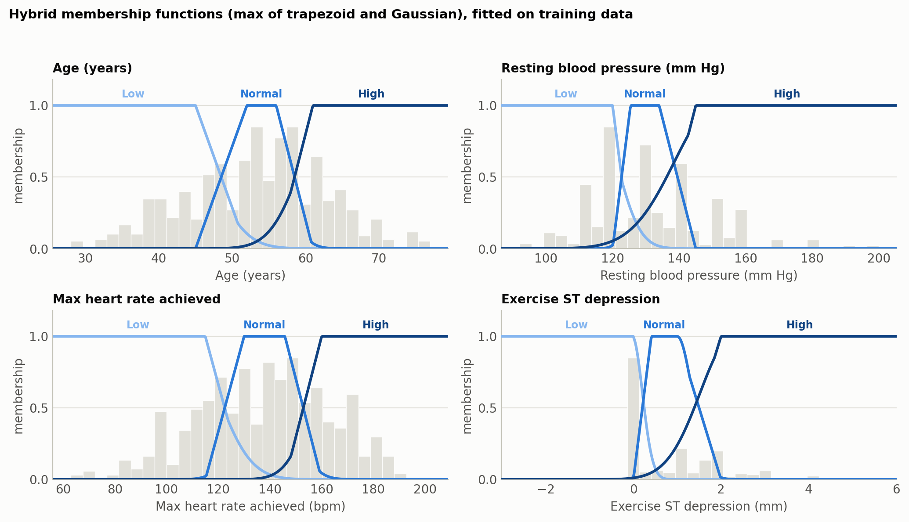
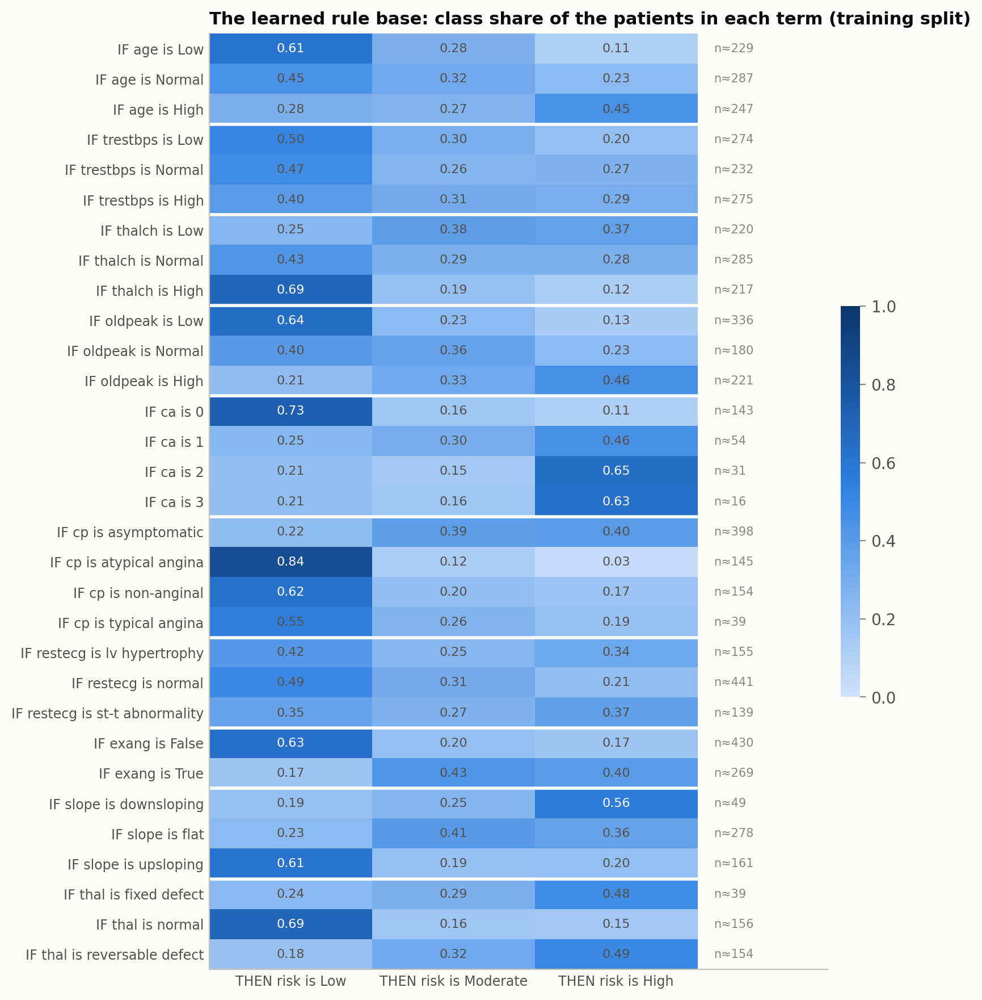
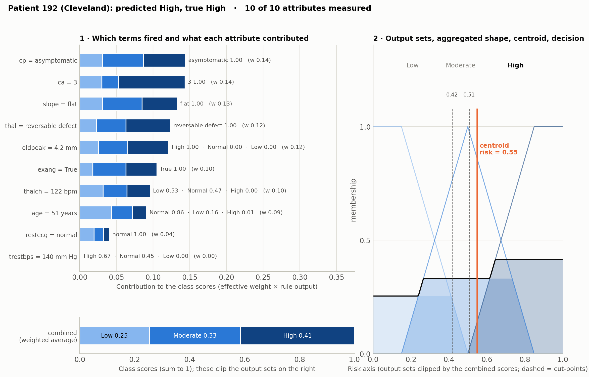
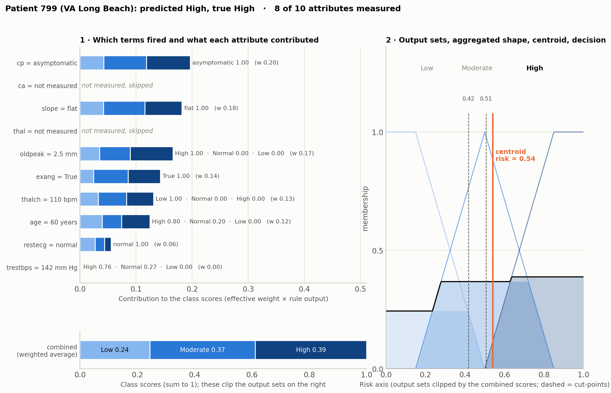
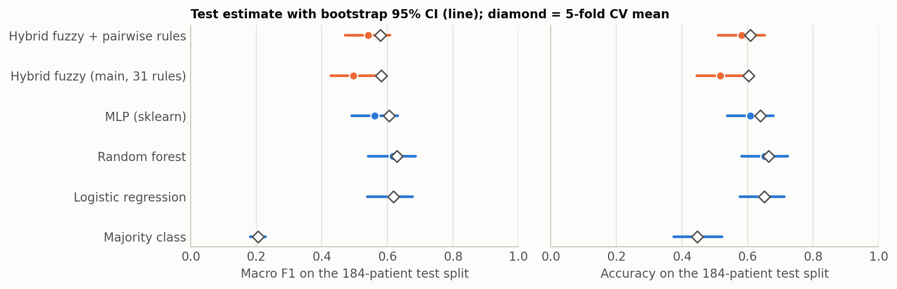
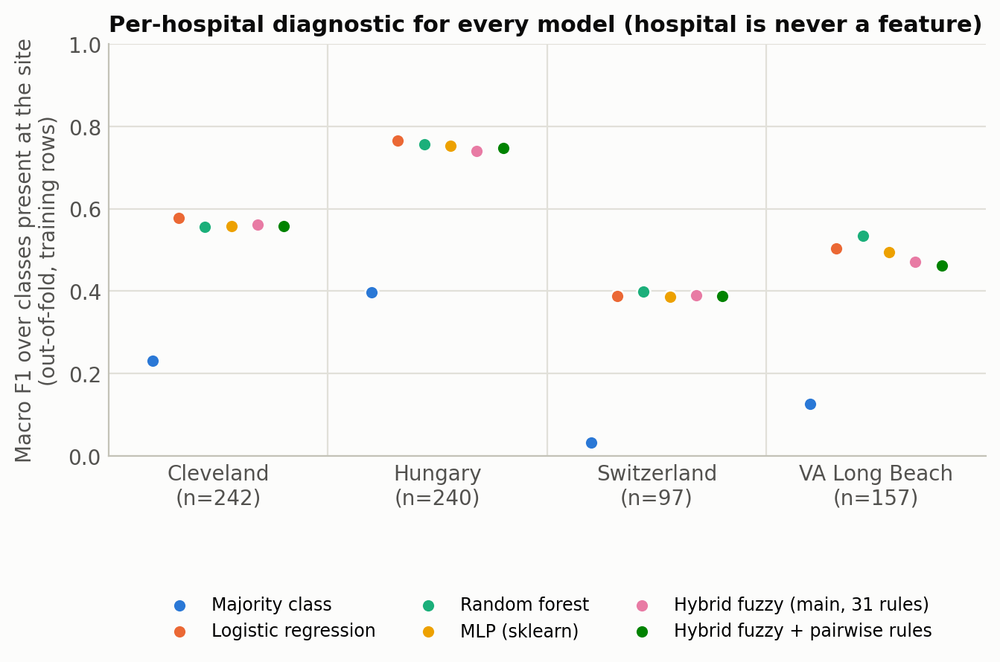

# Hybrid Fuzzy Membership Model for Cardiac State Prediction

A clean, open reimplementation of the method described in **Indian Patent No. 601763**,
*System and Method for Predicting a State of a Heart Using a Hybrid Fuzzy Membership Model*
(Application 202441004228, filed 19 January 2024, granted 8 September 2026; applicant Vellore
Institute of Technology; inventors Siva Shanmugam G, Anbarasi M, Anusha Seshadri, Iyashi Pal).

The original research code was not preserved, so this repository rebuilds the pipeline from the
granted specification, on the public UCI Heart Disease dataset, with every design decision written
down. It is a faithful reimplementation of the patented *method*, not a copy of the original
experiments, and the numbers it produces are its own.

**Tags:** Healthcare AI · Fuzzy Logic · Explainable AI · Feature Selection · Metaheuristics · Python

## The method in one paragraph

Patient records are cleaned (mean imputation, scaling, outlier handling), a subset of attributes is
chosen with **Binary Brain Storm Optimization** (a population metaheuristic that maximises
cross-validated F1), each selected attribute is fuzzified with a **hybrid membership function**
that takes the element-wise maximum of a trapezoid and a Gaussian, a rule base maps the fuzzified
inputs to a risk output through weighted-average aggregation, and **centroid defuzzification** turns
the fuzzy output into one crisp, explainable risk value. The design goal is a predictor that
handles the imprecision of clinical data while remaining readable by a clinician.

## Build status

| Phase | Content | Status |
|---|---|---|
| 1 | Data loading, risk labels, leakage-safe preprocessing | done |
| 2 | Baselines: logistic regression, random forest, small MLP, majority-class floor | done |
| 3 | Binary Brain Storm Optimization for feature selection | done |
| 4 | Hybrid trapezoidal + Gaussian membership functions, data-derived | done |
| 5 | Fuzzy inference: per-attribute rules, weighted average, centroid | done |
| 6 | Consolidated evaluation with bootstrap CIs, per-hospital view, explainability | done |

## Repository layout

```
data/                heart_disease_uci.csv (raw); processed/ is regenerated and git-ignored
figures/             all figures, numbered by phase
notebooks/           one walkthrough notebook per phase
results/             metric tables (CSV), numbered by phase
scripts/             one runnable script per phase
src/hfm/             the library: config, data, preprocess, models, evaluation, bbso, membership, fuzzy_model, plotting
tests/               pytest suite
```

## Setup

```bash
python -m venv .venv && source .venv/bin/activate
pip install -r requirements.txt
pip install -e .                      # makes `import hfm` work everywhere
pytest                                # 47 tests
python scripts/phase1_preprocess.py   # writes data/processed/ and figures/01_*.png
python scripts/phase2_baselines.py    # writes results/02_*.csv and figures/02_*.png
python scripts/phase3_bbso.py         # ~90 s; writes results/03_* and figures/03_*.png
python scripts/phase4_membership.py   # writes results/04_*.csv and figures/04_*.png
python scripts/phase5_fuzzy_inference.py  # ~15 s; writes results/05_* and figures/05_*.png
python scripts/phase6_final.py            # ~60 s; every model, bootstrap CIs, per-hospital view
```

## Data

The patent does not name its dataset, but its sample counts (919 rows for the fuzzy model and a
184-row test set for the deep-learning baseline) match the
[UCI Heart Disease dataset](https://archive.ics.uci.edu/dataset/45/heart+disease)
(Janosi, Steinbrunn, Pfisterer, Detrano): 920 patients from Cleveland, Hungary, Switzerland and
VA Long Beach, 13 clinical attributes, and a target `num` from 0 (no significant narrowing) to 4.
The CSV in `data/` is the Kaggle mirror of that dataset.

Two facts about this data shape everything downstream:

- **Zeros that mean missing.** 172 rows have a serum cholesterol of 0 and one has a resting blood
  pressure of 0. These are impossible measurements and are treated as missing before imputation.
- **Missingness follows the hospital.** Switzerland recorded no cholesterol; Hungary and VA
  largely skipped the fluoroscopy (`ca`, 66% missing overall) and thalassemia (`thal`, 53%) tests.



### Risk labels

The patent reports three classes (Low / Moderate / High) but does not say how they were derived.
This project maps the 0–4 target as follows and keeps the alternative available in
`hfm.config.RISK_MAPPINGS`:

| mapping | Low | Moderate | High | sizes |
|---|---|---|---|---|
| `default` (used) | `num = 0` | `num = 1` | `num = 2, 3, 4` | 411 / 265 / 244 |
| `severe_only` | `num = 0` | `num = 1, 2` | `num = 3, 4` | 411 / 374 / 135 |

`default` separates no significant disease, single-vessel disease and multi-vessel disease, and
keeps enough High-risk patients for stratified cross-validation. Neither mapping reproduces the
class supports printed in the patent (450 / 355 / 114), which cannot come from any monotone
grouping of `num`; that discrepancy is documented rather than reverse-engineered.



The source hospital is a strong proxy for the label (Hungary has no High-risk patients at all) and
is deliberately **not** used as a feature.

### Preprocessing

Implemented as a scikit-learn `ColumnTransformer` in `src/hfm/preprocess.py`. The stratified
80/20 split (seed 42) is drawn first, and every statistic is fitted on the training rows only.

| branch | attributes | steps |
|---|---|---|
| continuous | age, trestbps, chol, thalch, oldpeak | IQR clip → mean impute → scale |
| discrete | ca | mean impute → scale |
| categorical | sex, cp, fbs, restecg, exang, slope, thal | mode impute → one-hot |

Where this departs from the patent's wording, and why:

1. Outliers are **clipped to Tukey fences rather than removed**, so that every held-out patient
   stays in the evaluation.
2. Fences are computed on **observed values before imputation**. Clipping after imputation on a
   66%-missing column collapses it onto its mean and erases the feature (this was caught by a
   test). The discrete vessel count is never clipped.
3. Categorical attributes are imputed with the **mode**, since a category has no mean.
4. One scaler at a time (`standard`, `minmax` or `none`); the fuzzy phases will use unscaled
   values so membership functions stay in clinical units.

## Baselines

Every model is evaluated as a `Pipeline(preprocessor, model)` so that imputation means, clip
fences and scaling are refitted inside each fold of a stratified 5-fold CV on the 736 training
rows, and once more on all of them before scoring the 184-row test split. Hyper-parameters are
fixed and untuned; these models are context for the fuzzy model, not contenders.

| model | CV macro F1 (mean ± sd) | CV accuracy | test macro F1 | test accuracy |
|---|---|---|---|---|
| majority class (always *Low*) | 0.21 ± 0.00 | 0.45 | 0.21 | 0.45 |
| logistic regression | 0.62 ± 0.05 | 0.65 | 0.61 | 0.65 |
| random forest (500 trees) | 0.63 ± 0.05 | 0.66 | 0.62 | 0.65 |
| MLP (32, 16), early stopping | 0.61 ± 0.04 | 0.64 | 0.56 | 0.61 |

Full tables, per-class F1 and confusion matrices are in `results/02_*.csv` and
`figures/02_*.png`. Two observations carry forward:

- *Low* is the easy class and *Moderate* the hard one: every model confuses single-vessel
  disease with both of its neighbours.
- The majority-class row is the floor for *this* label setup (accuracy 0.45). The patent's
  reported metrics (accuracy 0.43, weighted F1 0.40) were computed on class supports of
  450 / 355 / 114 that do not match any grouping of `num`, so they come from a different label
  setup and are not directly comparable to the numbers here.

**On the neural baseline.** The patent's deep-learning comparison used a Keras Sequential
network. This project uses scikit-learn's `MLPClassifier` with an equivalent architecture (two
hidden layers of 32 and 16 units, ReLU, Adam, early stopping). A Keras wrapper with the same
interface is kept in `src/hfm/keras_optional.py` but is not part of the default pipeline or the
tests, because TensorFlow and scikit-learn each load their own OpenMP runtime on macOS and the
first Keras training step deadlocks after scikit-learn has trained a model in the same process.

**Per-hospital diagnostic.** The source hospital is never a feature, but
`hfm.evaluation.per_site` reports metrics per site for every model. Switzerland is the hard site
for all baselines (no cholesterol values, almost no fluoroscopy, 93% of patients *Moderate* or
*High*); Hungary is the easy one (no *High* patients at all). Later phases are checked against
this breakdown so that gains on easy sites do not hide losses on the hard one.



## Feature selection with Binary Brain Storm Optimization

`src/hfm/bbso.py` implements the binary variant of Brain Storm Optimization: a population of
candidate masks is clustered with k-means, new candidates are generated by perturbing a cluster
centre or a random member, or by merging two clusters, a sigmoid transfer function turns the
perturbed positions into bits, and a candidate replaces its parent when it scores better. The
search stops after 12 iterations without improvement (50 at most).

- The search runs over the **13 clinical attributes**, not the 22 encoded columns; a one-hot
  attribute is kept or dropped as a whole.
- **Fitness** is the macro F1 of logistic regression under an inner 3-fold stratified CV on the
  training split only. Preprocessing is fitted per inner fold and reused for every mask, and
  fitness is cached per mask (shared across seeds).
- Ten seeds, then per-attribute selection frequency and the most frequent best mask.

**A deliberate modification of standard BBSO.** In the textbook binary variant each idea is a
real-valued position and every bit is re-sampled from `sigmoid(position)` whenever the idea is
perturbed. On this problem that re-sampling destroyed good masks faster than the search could
find them: on a planted 13-bit toy objective it reached the optimum in 0 of 10 seeds. This
implementation therefore *anchors* a position to the mask it was scored with (sign of each
coordinate set to its bit, magnitude floored at 1.5, so a child keeps each parent bit with
probability about 0.82 before step noise is added). With anchoring the toy objective is solved
in 10 of 10 seeds. The clustering, generation rules, sigmoid transfer, greedy replacement and
early stopping are otherwise as in the standard algorithm. See `BBSO._evaluate` in `src/hfm/bbso.py`.

Ten seeds take about 80 s on a laptop (5,460 fitness calls, 2,720 unique masks scored); the
subset-versus-all evaluation adds about 8 s. Seven of ten seeds agree on the same ten-attribute
mask; `fbs` is never kept and `sex` and `chol` are kept by two seeds each.



Two findings, stated plainly:

- **The inner-CV gain does not transfer.** Fitness rose from 0.614 (all 13) to 0.640 (chosen
  subset), but under the outer 5-fold CV and on the test split the subset and the full set are
  within one fold's standard deviation for all three baselines. The gain is mostly selection
  optimism. The value of the subset is a smaller, cleaner input for the fuzzy model, not accuracy.
- **`ca`, `thal` and `slope` are kept by every seed.** These are the attributes that are mostly
  missing outside Cleveland and were filled with the training mode or mean, so after imputation
  they partly encode which hospital a patient came from. No missingness indicators were added;
  the per-hospital diagnostic is the check on whether that signal generalises.

| model | all 13, CV macro F1 | BBSO subset, CV macro F1 | all 13, test | subset, test |
|---|---|---|---|---|
| logistic regression | 0.62 ± 0.04 | 0.62 ± 0.05 | 0.61 | 0.60 |
| random forest | 0.63 ± 0.05 | 0.64 ± 0.05 | 0.62 | 0.59 |
| MLP | 0.61 ± 0.04 | 0.58 ± 0.04 | 0.56 | 0.57 |

## Hybrid membership functions

This is the patent's core idea: for each linguistic term, the membership of a value is the
**element-wise maximum of a trapezoid and a Gaussian**. The patent hand-picked the parameters.
Here `src/hfm/membership.py` derives every parameter from the training split, from observed
(non-imputed) values only, in clinical units:

- Trapezoid break points are training quantiles (20 / 40 / 60 / 80 %). *Low* is fully true
  below q20 and fades out by q40; *Normal* is fully true between q40 and q60; *High* is fully
  true above q80. Ramps are kept at least 5 % of the observed range wide, so an attribute with
  a pile-up at one value (`oldpeak` is 0 for a third of patients) still gets readable terms.
- The Gaussian of a term has mean and standard deviation equal to those of the training values
  whose trapezoid membership in that term is at least 0.5, with the mean clamped into the term's
  plateau.



**Fuzzy terms only for continuous attributes.** The four continuous attributes in the BBSO
subset (`age`, `trestbps`, `thalch`, `oldpeak`) get *Low / Normal / High*. The categorical
attributes (`cp`, `restecg`, `exang`, `slope`, `thal`) and the vessel count `ca` get **crisp**
terms: one per category, membership 1 for the patient's own category and 0 for every other.
A chest-pain type or an ECG finding is a recorded fact with no ordering and no overlap between
categories, so there is nothing for a fuzzy boundary to express; `ca` takes four integer values
and is imputed for two thirds of patients, so spreading it over fuzzy terms would add uncertainty
the data does not contain. The result is 31 membership columns for the ten attributes.

**Shape check.** A maximum of two shapes can turn a term into a two-humped curve if the Gaussian
peak sits outside the trapezoid plateau (the patent's own FIG. 4 has that shape). `shape_check`
samples every hybrid term on a fine grid and counts its peaks; the result is in
`results/04_shape_check.csv`. On the first fit one term failed: the `oldpeak` *Normal* core mean
was 1.05 mm, just past its plateau edge at 1.00 mm, and produced a second bump of height 0.01.
Clamping the Gaussian mean into the plateau removed it, and the clamp is a guarantee rather than
a patch: left of the plateau both components are non-decreasing, right of it both are
non-increasing, so their maximum is single-peaked by construction. The unclamped mean is kept in
the parameter table (`mu_raw`, `mu_clamped`) so the case stays visible. All twelve terms are
single-peaked.

**Missing values: a deliberate fuzzy approach.** The fuzzy model does not impute. A missing
reading gets membership 0 in every term of its attribute, so no rule can fire on it; the
inference step skips that attribute for that patient and renormalises the weights of the
measured ones. Nothing is filled and no missingness indicator is added, so the fuzzy model
cannot learn the source hospital from the pattern of what was recorded. This differs from the
baselines, which see the training mean or mode in those cells. The fuzzifier records which cells
were missing so that an explanation can say "not measured".

## Fuzzy inference and defuzzification

`src/hfm/fuzzy_model.py` turns the membership functions into a classifier with the structure the
patent describes:

1. **One fuzzy model per attribute.** Each linguistic term is the antecedent of one rule,
   `IF attribute IS term THEN risk IS …`. The consequent is learned from the training split as the
   membership-weighted class share of the patients in that term (Laplace-smoothed). For a patient
   the attribute's rules fire with the term memberships and their consequents are combined by
   firing strength into a per-attribute class-score vector. The whole rule base is 31 rules.
2. **Weighted average across attributes.** Weights are learned on an inner 3-fold CV of the
   training split as the single-attribute model's macro F1 above the majority-class floor,
   normalised. An attribute that was not measured for a patient is skipped and the remaining
   weights renormalised.
3. **Output sets and centroid.** The combined scores clip three output sets (Low / Moderate /
   High) on a risk axis from 0 to 1; the aggregated shape is defuzzified by the centre-of-gravity
   method into one crisp risk score.
4. **Cut-points** on the risk axis, chosen on inner-CV out-of-fold scores of the training split
   to maximise macro F1.

The model is a scikit-learn estimator over the cleaned raw frame, so it is evaluated by exactly
the same code as the baselines.



**Pairwise variant.** A compact two-antecedent layer can be switched on (`pair_top_k=3`): rules
`IF a IS t1 AND b IS t2` over every pair of the three highest-weight attributes (`cp`, `ca`,
`slope`), firing with the product of the two memberships, learned and weighted like a single
attribute, with rules supported by fewer than five training patients pruned. That adds 29 rules
for a total of 60, still one page. It was evaluated in a time-boxed improvement round and the
main model was chosen by CV macro F1 on the training split, as decided before the round.

## Results

### The interpretability story

The patented method is a classifier whose every step can be read by a person. The data (920
patients from four hospitals) are cleaned and labelled; Binary Brain Storm Optimization picks ten
of the thirteen clinical attributes; each continuous attribute gets *Low / Normal / High* terms
whose shapes come from the training data in clinical units; each term is one rule whose
consequent is the class share of the patients in it; the rules fire with the patient's
memberships, the attributes are averaged with weights that reflect how informative each one is,
and the result is defuzzified by centre of gravity into one risk score on a 0–1 axis.

For any patient the model returns a full account: which terms fired and how strongly, what each
attribute contributed, the combined scores, the output shape, the centroid and the decision. A
patient with missing tests is scored on what was measured, with the missing attributes shown as
skipped rather than filled in. The rule base (shown in the previous section) fits on one page, and
the two figures below are that account for a complete Cleveland record and for a VA record with
two tests never done.





### The numbers

All models under one protocol: 5-fold stratified CV on 736 training rows with every statistic
refitted inside the fold, then one fit on all training rows scored on 184 held-out rows with
2,000-sample bootstrap 95% confidence intervals. The patent's label setup differs from this one
(see the note on class supports), so its reported figures are not used as a benchmark.

| model | CV macro F1 (mean ± sd) | test macro F1 [95% CI] | test accuracy [95% CI] | vs. random forest, macro F1 [95% CI] |
|---|---|---|---|---|
| majority class (always *Low*) | 0.21 ± 0.00 | 0.21 [0.18, 0.23] | 0.45 [0.38, 0.52] | −0.41 [−0.49, −0.33] |
| logistic regression | 0.62 ± 0.05 | 0.61 [0.54, 0.68] | 0.65 [0.58, 0.71] | −0.01 [−0.07, 0.06] |
| random forest | 0.63 ± 0.05 | 0.62 [0.54, 0.69] | 0.65 [0.58, 0.72] | reference |
| MLP (32, 16) | 0.61 ± 0.04 | 0.56 [0.49, 0.63] | 0.61 [0.54, 0.68] | −0.06 [−0.13, 0.01] |
| **hybrid fuzzy, main (31 rules)** | 0.58 ± 0.03 | 0.50 [0.43, 0.57] | 0.52 [0.45, 0.59] | −0.12 [−0.20, −0.04] |
| hybrid fuzzy + pairwise rules (60 rules) | 0.58 ± 0.04 | 0.54 [0.47, 0.61] | 0.58 [0.51, 0.65] | −0.08 [−0.15, −0.01] |



- The three conventional baselines are indistinguishable from one another: every paired
  difference against the random forest includes zero.
- The main fuzzy model is about 0.05 macro F1 behind the baselines under CV, and further behind
  on the held-out split. It is the only model whose CV mean falls outside its own test CI, and its
  paired difference to the random forest excludes zero, so the CV-to-test drop is not noise. The
  likely cause is cut-point fragility: the two thresholds sit on a compressed risk axis (nearly
  all patients between 0.33 and 0.57), so a small shift in the test distribution moves many
  patients across them. An argmax decision that bypasses the centroid is worse under CV, so the
  defuzzification itself is not the problem.
- The pairwise variant ties the main model under CV (0.579 vs 0.581, which is why it did not
  become the main model), widens the risk axis slightly, and does better on the held-out split
  with its CV mean inside its CI. That better test score is reported, not used for selection.
- *Moderate* (single-vessel disease) is the hard class for every model: out-of-fold Moderate F1
  is about 0.47 across the board.
- Per hospital, on out-of-fold training predictions, the fuzzy models match the baselines at
  Cleveland, Hungary and Switzerland and trail slightly at VA Long Beach. They reach the Swiss
  result without a single imputed value.



### Limitations

- **Accuracy.** Single-antecedent rules cannot express interactions between attributes; the
  pairwise layer recovers some of that, not all. The conventional baselines are better classifiers
  on this data, and the gap is statistically clear on the held-out split.
- **Cut-point fragility.** Two thresholds on a compressed risk axis are sensitive to distribution
  shift. Calibrating the combined scores before defuzzification, or regularising the cut-points,
  is the obvious next step and is in the backlog.
- **Hospital-linked attributes.** `ca`, `thal` and `slope` are measured mostly at Cleveland and
  carry the highest weights. The fuzzy model never imputes them, but their presence still differs
  by site; the ablation in the backlog would quantify that dependence.
- **Labels.** The Low / Moderate / High mapping is this project's choice. The patent's class
  supports do not match any grouping of `num`, so its reported metrics are not comparable.
- **Data and scope.** 920 patients from four hospitals, collected decades ago. This is a research
  reimplementation; nothing here is validated for clinical use.

## Backlog

Ideas worth running, not yet done:

- **Cut-point robustness.** Calibrate the combined class scores (e.g. temperature scaling on the
  inner CV) before defuzzification so the risk axis is not compressed, or choose the cut-points
  with a smoothness penalty, and check whether the CV-to-test drop closes.

- **Hospital-linked imputation ablation.** `ca`, `thal` and `slope` are mostly missing outside
  Cleveland and are filled with the training mode or mean, so after imputation they partly encode
  the source hospital. Re-run feature selection, the fuzzy model and the baselines with those
  three attributes dropped and compare the per-hospital breakdown, to measure how much of their
  selection and predictive value rests on that imputation.

## Patent

- Indian Patent No. 601763, publication IN601763 B1, granted 8 September 2026
- IPC: G06N20/10, G06F18/2337, G06F18/26, G16H10/60, G16H50/30, A61B5/02, G06N5/048
- Claims 1–8 (claim 1: method; claim 6: system)

## License

Code in this repository is released under the MIT License. The patent itself is owned by Vellore
Institute of Technology; this reimplementation is published by one of the inventors for research
and educational use.
